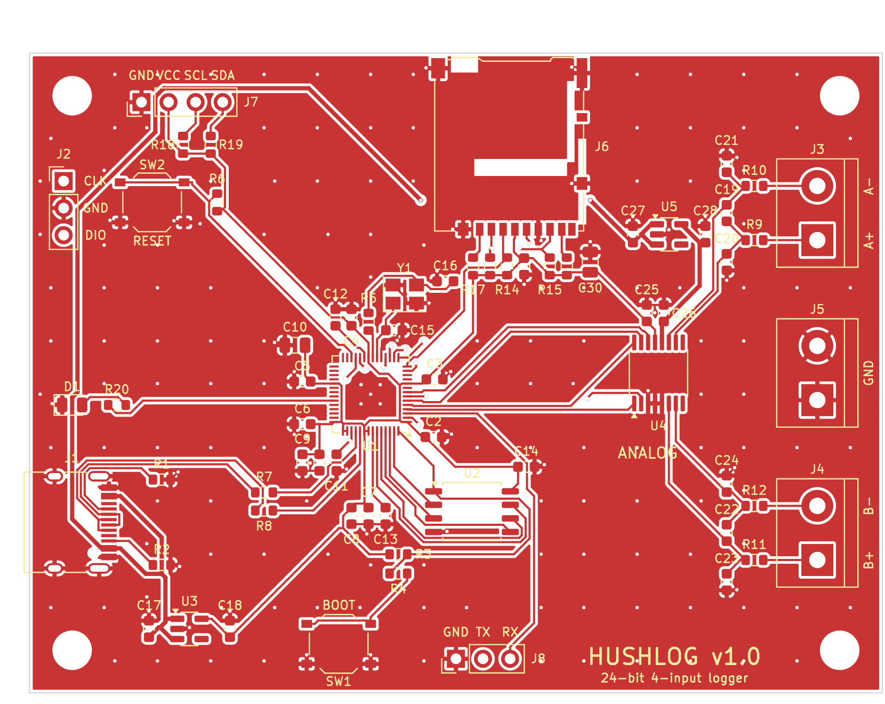

# Hushlog

A 4-channel, 24-bit data logger for small, slow signals - thermocouples, strain
gauges, photodiodes, RTDs.

Most DIY loggers read tiny voltages with the microcontroller's built-in ADC,
which is fine until the signal is small, at which point it's mostly noise.
Hushlog uses a real 24-bit precision ADC (the TI ADS1220) with differential
input channels, read by a bare RP2040, logged to a microSD card, with a small
OLED for live readings - all on a custom 2-layer board.

The thing I care about most is keeping it **quiet**: a separate low-noise supply
for the analog side, RC filtering on every input, and a layout that keeps the
digital switching noise away from the ADC. The plan is to short the inputs,
measure the noise floor, and compare it to the datasheet - that number goes in
this repo, good or bad.

## Repo layout

| Folder | What's in it |
|---|---|
| `hardware/` | KiCad 10 project - schematic + PCB |
| `firmware/` | RP2040 test firmware (PlatformIO / Arduino-Pico) |
| `fab/` | Gerbers, drill files, placement, fabrication BOM |
| `docs/` | Schematic render and board images |
| `reports/` | ERC and DRC reports |

## Status

Design complete for the Hack Club Half Life warm-up (Tier 2).

- [x] RP2040 core - MCU, QSPI flash, crystal, USB-C + LDO power, BOOTSEL/RESET, SWD
- [x] ADS1220 analog front end - two differential channels, computed input
      filters, SPI0, separate low-noise LDO (AVDD isolated from the digital rail)
- [x] microSD (SPI1), OLED header (I2C1), status LED, UART debug header
- [x] PCB layout - 2-layer, analog/digital split, solid ground pour under the ADC
- [x] Test firmware - brings up ADC, SD, OLED, LED and UART
- [ ] Noise-floor measurement on real hardware

## Design choices

- **Bare RP2040, not a Pico module** - the MCU circuit is designed from scratch
  (reference design followed pin-for-pin so it boots first try).
- **External QSPI flash (W25Q128)** - the RP2040 has no internal flash.
- **Separate analog supply (TPS7A2033 LDO)** - the ADC gets its own low-noise
  supply fed from USB VBUS, so RP2040 switching noise never couples into the
  measurement.
- **Two differential input pairs** - suits small differential sensors
  (thermocouples, strain gauges) at high PGA gain, rather than single-ended.
- **2-layer board** - kept simple for a first build.

## Firmware

See [`firmware/README.md`](firmware/README.md). It's a bring-up test: it
configures the ADS1220, reads two differential channels, and streams the
readings over USB serial, SD and the OLED. Written for the Arduino-Pico core,
built with PlatformIO.

## Parts

Headline parts (full list in `BOM.md` and `fab/`):

| Part | Role |
|---|---|
| RP2040 | microcontroller |
| W25Q128 | QSPI boot flash |
| ADS1220 | 24-bit ADC |
| AP2112K-3.3 | 3.3V LDO (digital) |
| TPS7A2033 | low-noise LDO (analog) |
| SSD1306 0.96" | OLED display |

Note: SD writes and OLED refreshes should be held off during ADC conversions to
keep them out of the noise floor - handled in the real logging loop, flagged in
the firmware TODO.
